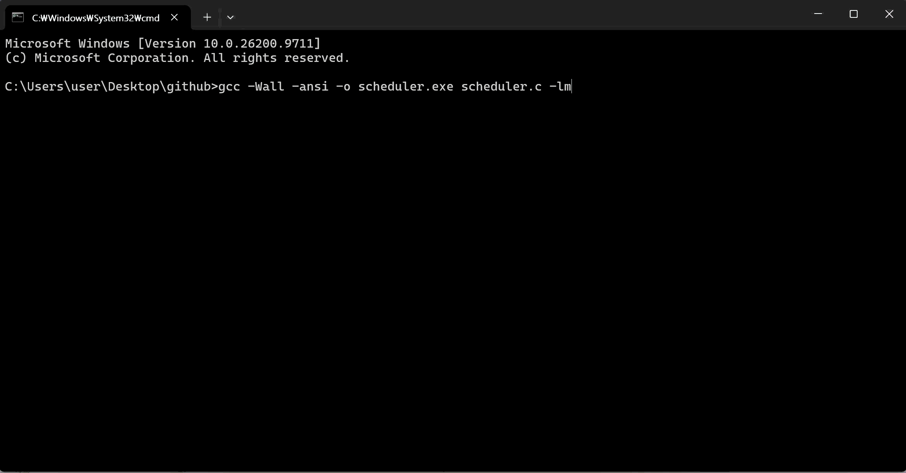
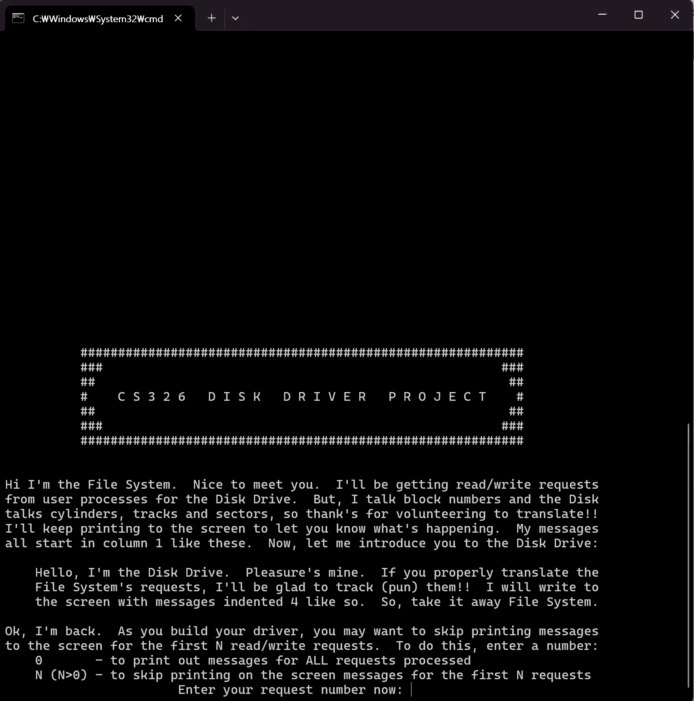
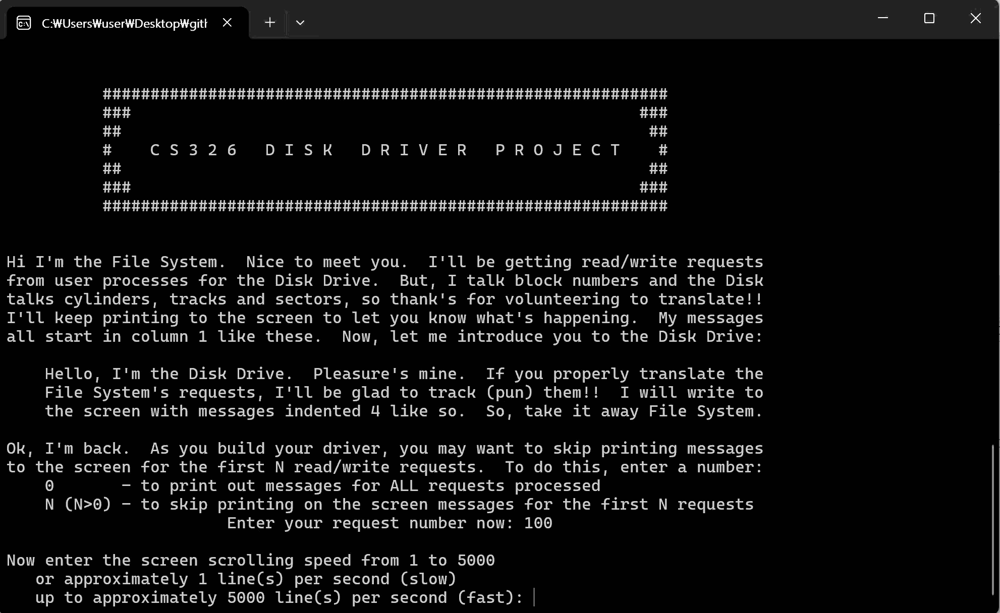

# Operating System Simulation Projects

운영체제의 핵심 메커니즘을 C 언어로 구현하고 시뮬레이션한 과제 아카이브입니다.  
> **Academic Integrity Notice**: 본 저장소는 소속 교육기관의 표절 규정을 준수하기 위해 소스코드는 비공개 처리되어 있으며, 설계 다이어그램, 핵심 로직 구조 및 실행 바이너리/데모 결과 위주로 아카이빙되어 있습니다.

---

## Project Index
1. [Unix Process Scheduler Simulation](#1-unix-process-scheduler-simulation)
2. [Disk Device Driver Simulation](#2-disk-device-driver-simulation)

---

## 1. Unix Process Scheduler Simulation

### Overview
Unix 환경에서 프로세스의 생성, 동적 우선순위 기반 CPU 스케줄링, I/O 블로킹, 종료에 이르는 전 생명주기를 재현한 이벤트 드리븐 시뮬레이터입니다.

- **Environment**: C (C89/ANSI C), GCC, POSIX `usleep`
- **Key Concepts**: Context Switching, Preemptive Dynamic Priority, Multi-level Queue Ordering, Singly Linked List with Sentinel Nodes

---

### System Architecture & Logic Flow

#### 1) Process State Transition Diagram
```text
           [ New Process ]
                  │
                  ▼
         ┌────────────────┐
         │     READY      │◄──────────────┐
         └───────┬────────┘               │
                 │ Dispatch               │ Unblocked (P=1/20)
                 ▼                        │
         ┌────────────────┐               │
         │    RUNNING     │────────┐      │
         └───────┬────────┘        │      │
                 │                 ▼      │
   Quantum / End │         ┌──────────────┴─┐
                 │         │    BLOCKED     │
                 ▼         │   (I/O Bound)  │
           [ Terminated ]  └────────────────┘

```

#### 2) Priority & Ordering Logic

* **Sentinel Nodes**: 헤더와 트레일러 노드를 사용해 리스트의 삽입/삭제 시 예외 분기를 최소화한 정렬 링크드 리스트를 사용합니다.


* **Priority Mapping**: 음수 우선순위(I/O Unblocked 우선 처리)와 양수 우선순위(CPU-bound)를 일관되게 정렬하기 위해 `sort_key` 변환 함수를 적용합니다.


* **우선순위 재계산 공식**:

$$
\text{PRI}_{\text{new}} = \left\lceil \frac{|\text{PRI}_{\text{old}}| + \text{Quantum Used}}{2} \right\rceil
$$

* **블로킹 여부에 따른 부호 부여**:

$$
\text{PRI}_{\text{final}} = 
\begin{cases} 
-\text{PRI}_{\text{new}} & \text{if process blocked (I/O Bound)} \\ 
+\text{PRI}_{\text{new}} & \text{if fully used quantum (CPU Bound)} 
\end{cases}
$$

* I/O 바운드(블록 발생) 프로세스는 음수 부호($-\text{PRI}$)를 부여받아 언블록 시 CPU를 최우선 선점합니다.


#### 3) Simulation Tick Cycle (60Hz Clock Interrupt)

```text
[Clock Tick (1/60s)] 
   ├── 1. Context Switch Check (Running Quantum 소진 or Idle & Ready 대기)
   │        └── Context Switch 발생 시: BEFORE/AFTER 테이블 출력 및 우선순위 재배치
   ├── 2. CPU Execution (Current Process CPU/Quantum Ticks 누적)
   ├── 3. Dynamic Process Arrival (20% 확률로 PID 생성, 최대 10개 제한)
   └── 4. I/O Check (각 Blocked 프로세스 5% 확률로 Ready 전이)

```

---


### Execution Demo


### Execution & Output Example

컨텍스트 스위칭이 일어나는 순간 시스템의 상태 변화(BEFORE/AFTER)를 기록합니다.

```text
 BEFORE SCHEDULING CPU:  Next PID =  6,  Number of Processes =  5
 PID   CPU Used   MAX Time   STATE   PRI   QUANTUM USED   BLK TIME   WAIT TKS
   1          6         12       R       0              0          6          0
   2          0          8       R       0              0          2          0
   3          0         15       R       0              0          4          0
   4          0          3       R       0              0          6          0
   5          0          9       R       0              0          1          0

 AFTER SCHEDULING CPU:  Next PID =  6,  Number of Processes =  5
 PID   CPU Used   MAX Time   STATE   PRI   QUANTUM USED   BLK TIME   WAIT TKS
   1          6         12       N       3              0          6          0
   2          0          8       R       0              0          2          0
   3          0         15       R       0              0          4          0
   4          0          3       R       0              0          6          0
   5          0          9       R       0              0          1          0

```

---

### Build & Verification
- **Build Command**: `gcc -Wall -ansi -o scheduler.exe scheduler.c -lm`
- **Integrity Policy**: 소스코드 원본은 학교 명예 규정에 따라 비공개 처리되어 있으며, 위 데모 GIF를 통해 정상 빌드 및 실행 결과를 확인하실 수 있습니다.

---

## 2. Disk Device Driver Simulation

### Overview
파일 시스템으로부터 LBA 기반의 Read/Write I/O 요청을 수신하여, 하드웨어 물리 규격(Cylinder, Track, Sector)으로 변환한 뒤 디스크 컨트롤러 및 DMA를 제어하는 디바이스 드라이버 시뮬레이터입니다[cite: 3].

- **Environment**: C (C89/ANSI C), GCC
- **Key Concepts**: Device Driver Architecture, Message Passing IPC, DMA Setup, Elevator (C-SCAN) Scheduling, Fault Tolerance (Checksum Retry & Head Recalibration)[cite: 3, 4]

---

### System Architecture & Logic Flow

#### 1) Layer Communication & Message Flow
디바이스 드라이버는 파일 시스템과 디스크 컨트롤러 사이에서 중계 및 하드웨어 보호 계층 역할을 수행합니다[cite: 3].

```text
  ┌─────────────────────────┐
  │       File System       │
  └───────────┬─────────────┘
              │ 1. send_message(fs_message) [IPC Struct Array]
              ▼
  ┌─────────────────────────────────────────────────────────┐
  │                   Disk Device Driver                    │
  │  - Parameter Verification (Bitmask Validation)          │
  │  - Block to CHS Address Translation                     │
  │  - Pending Queue Management (Ascending Block Order)     │
  │  - Elevator (C-SCAN) Head Movement Scheduling           │
  │  - Motor Power Management (2-Idle Auto Shutdown)        │
  └───────────┬─────────────────────────────────────────────┘
              │ 2. disk_drive(cmd, arg1, arg2, arg3, arg4)
              ▼
  ┌─────────────────────────┐
  │     Physical Disk       │ (40 Cylinders x 2 Tracks x 9 Sectors)
  └─────────────────────────┘

```

#### 2) Disk Geometry & Address Translation (LBA to CHS)

디스크는 40 실린더, 2 트랙/실린더, 9 섹터/트랙 규격을 가지며, 1개 블록(1,024 Bytes)은 2개의 연속된 물리 섹터(512 Bytes)로 구성됩니다.

* **Geometry Specifications**:
* Total Capacity: $40 \times 2 \times 9 \times 512\text{ bytes} = 368,640\text{ bytes}$


* Total 1KB Blocks: $360\text{ blocks}$ ($1 \sim 360$)


* **Translation Formula** (0-indexed LBA = `block_number - 1`):

$$\text{Cylinder} = \left\lfloor \frac{\text{LBA}}{\text{Sectors Per Cylinder}} \right\rfloor$$

$$\text{Track} = \begin{cases} 0 & \text{if } (\text{LBA} \pmod {\text{Sectors Per Cylinder}}) < 4.5 \\ 1 & \text{otherwise} \end{cases}$$

$$\text{Sector} = (\text{LBA} \times 2) \pmod {\text{Sectors Per Track}}$$

#### 3) Key Driver Mechanisms

* **Elevator (C-SCAN) Scheduling**:
* 들어온 요청들을 대기 큐(Singly Linked List with Sentinel)에 블록 번호 오름차순으로 정렬 유지합니다.


* 디스크 헤드가 현재 실린더에서 전진 방향($0 \to 39$)에 있는 가장 가까운 실린더 요청을 먼저 서비스하며, 끝에 도달하면 실린더 0 방향으로 랩어라운드합니다.


* 동일 블록에 대한 중복 요청은 파일 시스템에서 수신된 순서를 엄격히 보장합니다.


* **Hardware Fault Tolerance & Recovery**:
* **Checksum Error**: 일시적 데이터 전송 오류 발생 시 정상 읽기/쓰기가 완료될 때까지 재시도 루프를 수행합니다.


* **Seek Failure**: 헤드가 지정한 실린더에 안착하지 못했을 경우, 실린더 0으로 복귀할 때까지 `RECALIBRATE` 명령을 반복 수행한 뒤 기존 요청을 복구합니다.


* **Power Management**:
* 모터 기동 후 정상 회전 속도에 도달할 때까지 상태 검사를 거치며, 대기 큐가 비어 있는 상태에서 연속 2회 이상 유휴 신호가 감지되면 모터 과열 방지를 위해 전원을 차단합니다.


#### 4) Parameter Verification (Bitmask Error Mapping)

파일 시스템에서 잘못된 파라미터가 유입될 경우 하드웨어 동작을 차단하고 복합 비트마스크 에러 코드를 반환합니다.

$$\text{ErrorCode} = \sum_{\text{condition}} \text{Flag} \quad (\text{Valid: } 0, \text{ Invalid: } -1 \sim -31)$$

| 에러 조건 | 비트 플래그 값 | 설명 |
| --- | --- | --- |
| `INVALID_OPERATION_CODE` | `-1` | Read(1) 또는 Write(2) 이외의 명령 |
| `INVALID_REQUEST_NUMBER` | `-2` | 요청 번호가 0 이하인 경우 |
| `INVALID_BLOCK_NUMBER` | `-4` | 블록 번호가 $1 \sim 360$ 범위를 벗어난 경우 |
| `INVALID_BLOCK_SIZE` | `-8` | 블록 크기가 비정상이거나 2의 거듭제곱이 아닌 경우 |
| `INVALID_DATA_ADDRESS` | `-16` | 버퍼 메모리 포인터가 NULL인 경우 |

---

### Execution & Output Example

파일 시스템(`filesys.o`) 및 디스크 컨트롤러(`disk.o`)와 연동되어 실행되며, 드라이버 자체 디버그 출력 없이 하드웨어 레벨 로그만 포맷에 맞춰 출력됩니다.

```text
Pending file sys i/o requests ( ==> SHOULD BE NEXT, disk heads are at cyl 12):
===============================================================================
   Code   Request   Blk Number (cyl)   Blk Size   Data Adr (hex)   Blk Contents
   ----   -------   ----------------   --------   --------------   ------------
==>   1       104          58    ( 12)       1024         7FFE10A0   
      2       105         112    ( 24)       1024         7FFE14A0   

    START MOTOR, the disk motor has been turned on
    STATUS MOTOR, the disk motor is now up to speed
    SEEK Command to cylinder 12, landed on cylinder 12
    DMA SETUP, registers set: sector 4, track 1, blksize 1024, dataadr 7FFE10A0
    READ DISK, block number 58 from cylinder 12, sector 4, track 1

*******************************************************************************
Request number  104 is finished ***********************************************
*******************************************************************************
The read request has been processed SUCCESSFULLY!

```

---

### Execution Demo
프로그램 실행 시 디버깅 및 대량 테스트를 위한 2가지 스크린 출력 모드를 지원합니다:


- **`0` 입력 (Full Logging)**: 초기 요청부터 모든 파일 시스템 IPC 통신, DMA 설정, 디스크 헤드 동작 로그를 실시간으로 출력합니다 (위 데모 영상 기준).


- **`N` 입력 (Skip Logging / Fast-forward)**: 앞선 $N$개의 정상 처리 요청 출력을 생략하고 에러/경고 및 이후 요청만 빠르게 확인하여 장시간 스트레스 테스트 효율을 높입니다.

---

### Build & Verification

제공된 파일 시스템 드라이버 및 디스크 에뮬레이션 바이너리와 결합하여 빌드합니다.

```bash
# Compile driver object
gcc -Wall -ansi -c driver.c

# Link with File System & Disk Device modules
gcc -o driver.exe driver.o filesys.o disk.o -lm

# Execute driver
./driver.exe

```

> **Academic Integrity Notice**: `driver.c` 소스코드 및 교내 제공 바이너리(`filesys.o`, `disk.o`)는 기관 명예 서약에 따라 원본 배포가 제한되어 있습니다.
